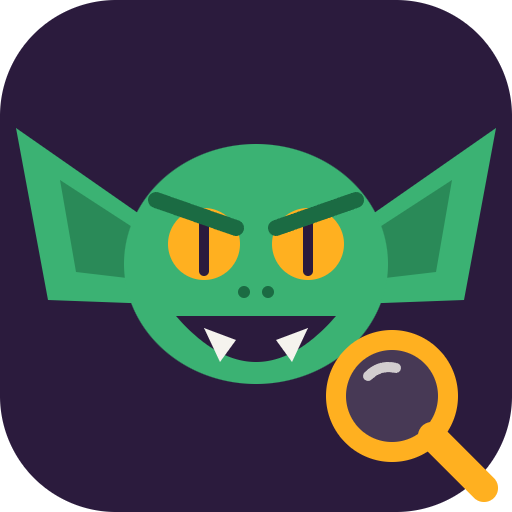
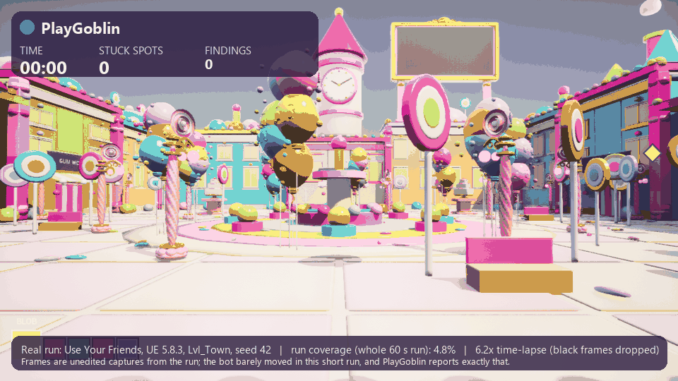
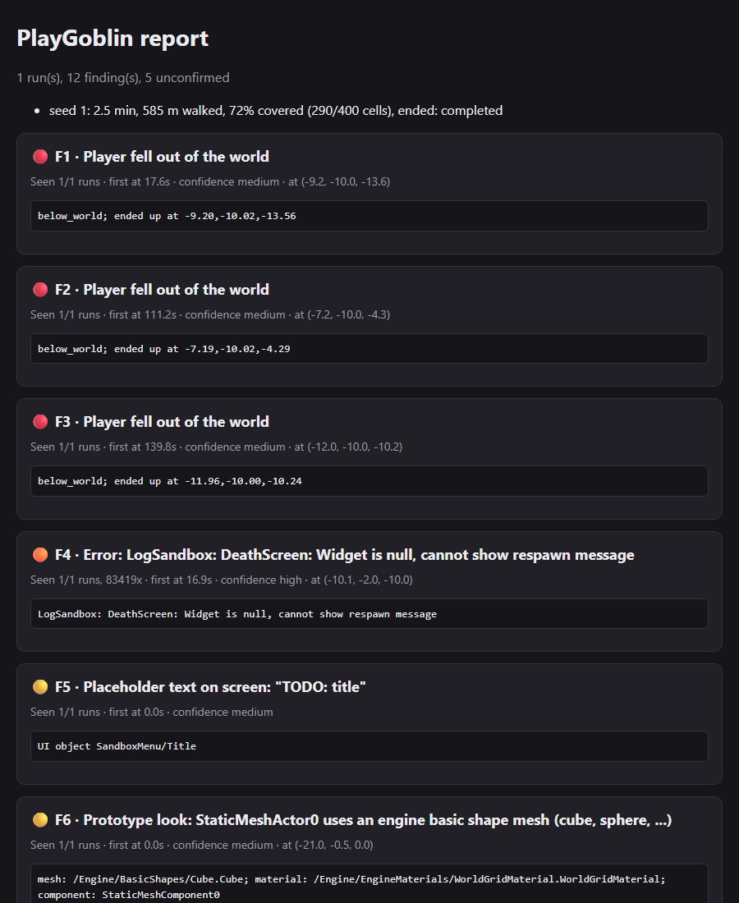

<p align="center"></p>

<h1 align="center">PlayGoblin</h1>

<p align="center"><b>An open-source QA bot that plays your game like a person and files the bugs with evidence.</b><br>
Unity, Unreal, or any engine that can write a log file. Deterministic checks, no LLM in the loop, no account.</p>

<p align="center"><br><sub>A real 150 s run on a UE 5.8 game (3x time-lapse of seconds 19-52, overlay added). Full run: 251 m walked, 19 waypoints, 12.0% coverage, 1 confirmed and 12 unconfirmed stuck spots.</sub></p>

<p align="center">
<a href="https://github.com/grloper/playgoblin/actions/workflows/ci.yml"></a>
<a href="LICENSE"></a>

</p>

<p align="center">
<br>
<sub>A frame PlayGoblin captured while walking the town level of a real Unreal Engine 5.8 game (Use Your Friends). Frames and clips like this are attached to findings.</sub>
</p>

> **Status: pre-release (0.1.0).** Works on Unity 6000.4, and on Unreal 5.8.3 (Win64) with a sample project and one real game.
> Expect rough edges. See [Status](#status) for exactly what has and has not been verified.

---

## What it catches

These come from real runs, not mock-ups. Most were found by running on a real Unreal Engine 5.8 game:

| Finding | What happened | Result |
|---|---|---|
| **No movement bindings** | The game had no input bound to move the pawn, so the bot could not leave the spawn point | `The player never moved` (critical) |
| **A level-sized invisible blocking volume** | One actor spanning the whole level hid the ground from every floor probe, so the bot saw nothing walkable | Bot bug found and fixed: it now skips actors it starts inside and logs them |
| **Grey-box / prototype look** | Visible actors still using `/Engine/BasicShapes` meshes or the engine grid material | `Prototype look: <actor> uses an engine basic shape mesh` (medium) |
| **Brand-pink false positive** | A pastel-pink game was flagged as "missing-material pink" | Fixed: only pure magenta (high R and B, near-zero G) counts. Exactly the kind of report we want from you |
| **Dead buttons and placeholder text** | On the Unreal sample: a UMG "Options" button that does nothing, menu text reading `TODO: title` | `dead_button`, `Placeholder text on screen` |

Also: crashes and exceptions (grouped by message), stuck spots (unconfirmed until they repeat), falls through the world, blank frames,
and FPS drops against a budget. Every finding has evidence: an event, a frame, or a log line. If the bot cannot show it, it does not report it.

<p align="center">
<br>
<sub>The real report for the Unreal sample project, which has planted bugs. The full report links frames and clips.</sub>
</p>

What it does **not** do: judge fun, balance, visuals or audio. It walks and clicks rather than playing to win, so "no findings" never means "bug free".

## 30-second quickstart

```bash
pip install "git+https://github.com/grloper/playgoblin#subdirectory=cli"   # the `playgoblin` command (Python 3.11+)
```

**Unity** (6000.4 tested): Package Manager > Add package from git URL > `https://github.com/grloper/playgoblin.git?path=/unity`,
add the **PlayGoblin Player** component to your player object, press Play, then:

```bash
playgoblin run --minutes 10 --runs 3      # walks, then writes playgoblin-report/report.html
```

**Unreal** (5.8.3 tested): copy `unreal/PlayGoblin` into your project's `Plugins/`, then run the game with `-playgoblin`:

```bash
UnrealEditor-Cmd.exe MyGame.uproject -game -playgoblin -PlayGoblinSeconds=300 -PlayGoblinSeed=1 -PlayGoblinOut=D:/runs -PlayGoblinExit
playgoblin report D:/runs/<run id>        # report.html, report.md, findings.json
```

Then, when you want tickets (a dry run unless you add `--yes`):

```bash
playgoblin file-issues --repo you/your-game
```

Details: [unreal/README.md](unreal/README.md), [docs/PROTOCOL.md](docs/PROTOCOL.md).

## Use it from an AI agent

PlayGoblin ships an MCP server and a Claude Code skill, and every command takes `--json`.

```json
{ "mcpServers": { "playgoblin": { "command": "playgoblin", "args": ["mcp"] } } }
```

| MCP tool | What it does |
|---|---|
| `playgoblin_status` | Is a game with PlayGoblin reachable, and what is it doing |
| `playgoblin_run` | Walk for N minutes (several seeds), then return the findings |
| `playgoblin_report` | Build a report from existing run folders, offline |
| `playgoblin_findings` | Read a report's findings |
| `playgoblin_file_issues` | File GitHub issues; **dry run unless `confirm: true`** |

This repo is also a Claude Code plugin (`.claude-plugin/`, `.mcp.json`, [`skills/playgoblin/SKILL.md`](skills/playgoblin/SKILL.md)).
The skill teaches the agent when to run PlayGoblin, how to read confidence (confirmed vs seen once), and that issues need your yes first.
[`llms.txt`](llms.txt) and [`AGENTS.md`](AGENTS.md) are the index and developer guide for coding agents.

## How it plays like a human

The Unreal plugin avoids shortcuts where it can:

- **Real input bindings.** It reads the game's own key and axis bindings and presses the keys that move the player (`-PlayGoblinKeys`). If nothing moves the player, that is a finding.
- **Mouse look.** It turns with simulated mouse movement, not by setting the camera. If the mouse does nothing after repeated probes, that is a `dead_input` finding.
- **Key presses.** It taps the game's action keys at irregular intervals and tries a jump when stuck.
- **Menu crawl.** It finds visible UMG menus, clicks each enabled button once, and reports buttons that change nothing and placeholder text (Unity: uGUI).
- **Coverage-driven walking.** It heads for the nearest unvisited ground next to what it has seen, not random spots. On the sample project (same seed, 150 s) coverage went from 34% to 73% on the planted level and 48% to 93% on the clean one. Every report prints coverage per run.

## Deterministic checks, no LLM

Checks are plain code, one pure function per check: run folder in, findings out. The same events give the same findings every time,
and the checks are unit tested (62 Python tests). An LLM is optional and only writes a summary paragraph, labelled as such.
Runs are seeded, and a stuck spot only counts as confirmed once it repeats, so one unlucky run does not file a fake bug.

## Engines

| Engine | Status |
|---|---|
| **Unity** | Package `com.playgoblin.unity`. Built and tested on Unity 6000.4 (80 edit-mode, 22 play-mode tests) and a sample game with planted bugs. Other versions, player builds, UI Toolkit: not tested |
| **Unreal** | C++ plugin. Compiles on UE 5.8.3 Win64 with 0 warnings. Finds all 5 planted bugs in its sample and nothing on the clean twin (one seed, one machine). Run on one real UE 5.8 game. Not yet: other versions or platforms, Enhanced-Input-driven menus |
| **Anything else** | Write `events.jsonl` + `run.json` ([run-folder protocol](docs/PROTOCOL.md)) and get the same checks and reports. [`writer.py`](cli/playgoblin/writer.py) is a short reference writer. Tested with a fake Godot-style run, not a real Godot game |

## How it compares

| | Manual QA | Recorded input replays | Generic test frameworks (Unity Test Framework, Unreal Automation) | PlayGoblin |
|---|---|---|---|---|
| Finds what a person would | Yes, and judges fun and feel | Only along the recorded path | Only what a test asserts | Crashes, stuck spots, falls, dead input and UI, placeholder art. Not fun |
| Runs unattended overnight | No | Yes | Yes | Yes |
| Level changes break it | n/a | Often | When tests hard-code positions | Walks whatever is reachable |
| You write tests | No | Record once | Yes | No (glue only for custom start flows) |
| Evidence per bug | Notes, if written | Pass/fail | Assertion message | Frames, clip, position, log line |
| Cost | People's time | Maintenance | Authoring time | Free, open source |

They complement each other: keep your assertions and your testers. PlayGoblin covers the "nobody walked there" gap.

## Status

| Part | State |
|---|---|
| Python CLI, report, MCP server | 62 tests, CI on Linux and Windows (Python 3.11 and 3.13) |
| Unity package | Verified on Unity 6000.4; the planted-bug sample was found in 5 of 5 seeds, no findings on the clean scene |
| Unreal plugin | Verified on UE 5.8.3 Win64: the sample (headless) and one real game (rendered frames) |
| Accuracy on real games | Not measured yet. The samples were written by the people who wrote the checks, so treat them as regression tests |

## Roadmap

- More real-game runs, and published precision numbers.
- Unreal: other engine versions, Enhanced Input, a hook for custom start flows.
- Unity: UI Toolkit buttons, 2022.3 and player builds, an editor-gizmo check.
- A GitHub Action, and comparing runs between builds ("new stuck spot since last night").

## Contributing

The most useful contribution right now: **run it on a game and tell us what it missed or got wrong**, with the run folder attached.
See [CONTRIBUTING.md](CONTRIBUTING.md) and [AGENTS.md](AGENTS.md).

## License

[Apache-2.0](LICENSE)
