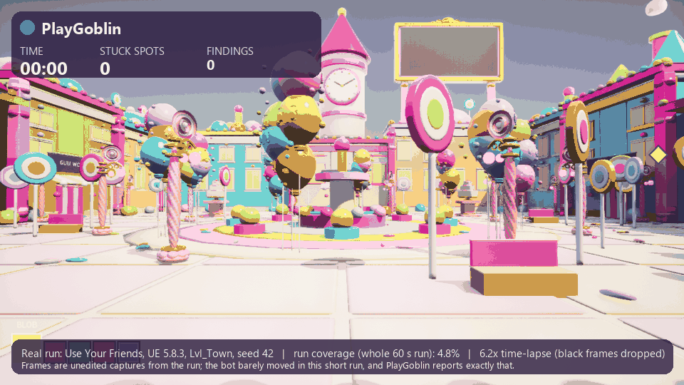
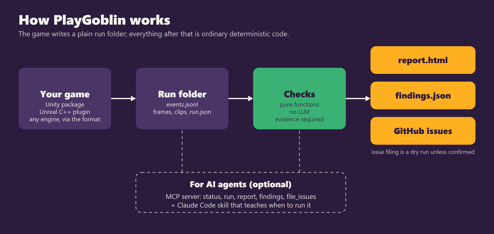
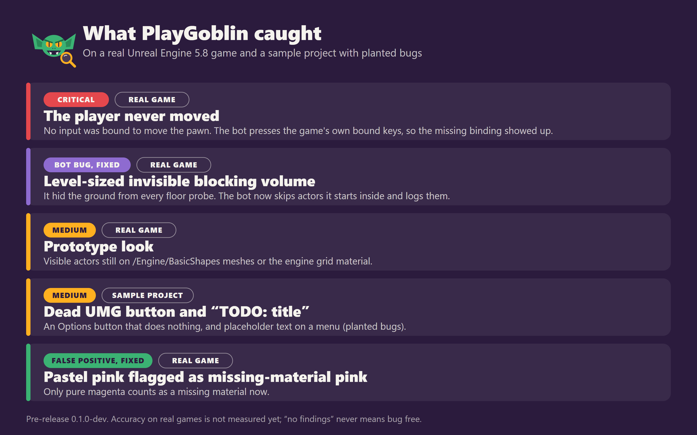
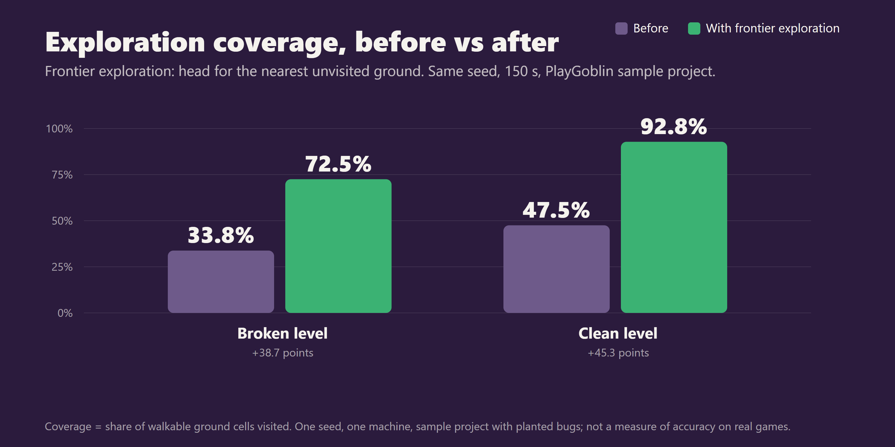
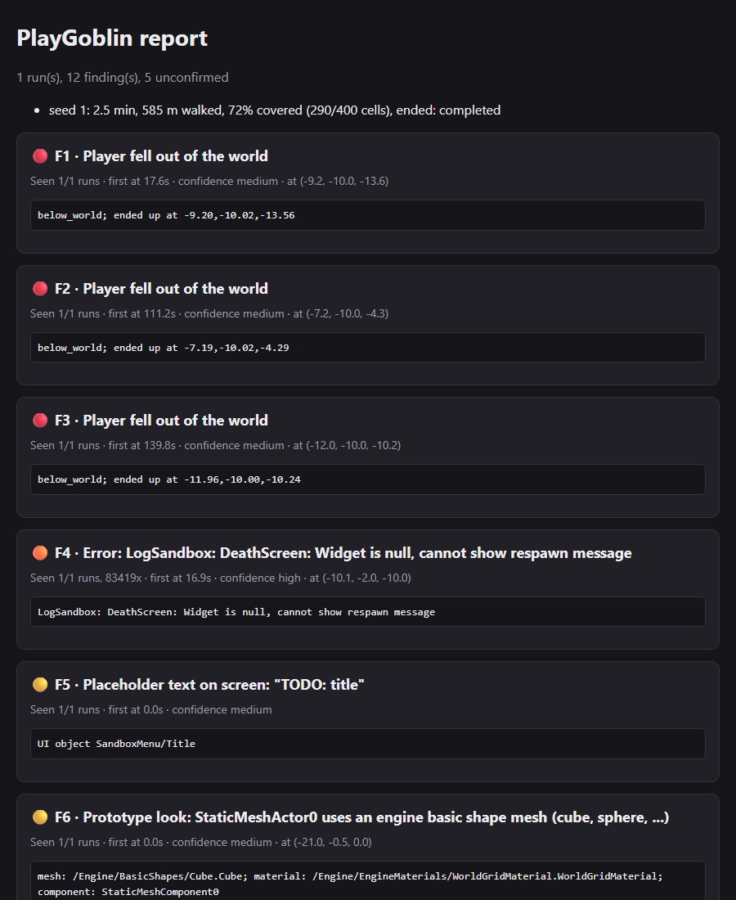

I'm making an indie game in Unreal Engine 5.8, and like most solo developers I have a testing problem: nobody walks the whole game after every change. I do it for ten minutes, see nothing wrong, and ship the build. So I wrote a bot to do the boring part, and I'm releasing it as open source. It is called PlayGoblin, and it is pre-release (0.1.0-dev), so please read the limits section before you get excited.



*A real 150 s run on my game, shown as a 3x time-lapse of seconds 19 to 52 (overlay added by me). The full run walked 251 m and reached 19 waypoints, but covered only 12.0% of the 1137 walkable cells; it logged 1 confirmed and 12 unconfirmed stuck spots. Coverage in the overlay is derived from sampled positions. The goblin is not a speedrunner yet.*

### The problem

Unit tests check what you thought to assert. Recorded input replays only cover the path you recorded and break when the level changes. Manual QA is great, but it does not run at 3 a.m. after every commit. The gap I care about is "nobody walked there": a stuck spot behind a prop, a fall through a missing collision, a menu button wired to nothing, a TODO that made it into a title screen.

### What PlayGoblin is

An engine-side component walks the game and writes a plain run folder: `events.jsonl` plus a summary. A Python CLI reads that folder and produces findings, an HTML report, and optionally GitHub issues. Each finding has evidence, meaning an event, a frame, or a log line. If the bot cannot show it, it does not report it.

There are engine sides for Unity (6000.4 tested) and Unreal (5.8.3 Win64 tested). Any other engine that can write the run-folder format (documented in `docs/PROTOCOL.md`) gets the same checks and reports. I tested that with a fake Godot-style run, not a real Godot game.




### The bugs it found on my game

I ran it on my Unreal game this week. Three results are worth telling honestly.

**The player could not move.** The game had no input bound to move the pawn. The bot, which reads the game's own key and axis bindings and presses the keys that should move the player, never left the spawn point and reported "The player never moved" as critical.

**A bug in the bot, found by the game.** My game has a level-sized invisible blocking volume. It hid the ground from every floor probe, so the bot saw nothing walkable. That was a bug in PlayGoblin, not in the game, and the fix is that the bot now skips actors it starts inside and logs them. Real games are weirder than sample projects, and this is why I am asking for run folders from yours.

**Grey-box look.** It lists visible actors still using `/Engine/BasicShapes` meshes or the engine grid material and reports each as "Prototype look". It is a cheap way to see how much of a level is still placeholder art.

On the Unreal sample project, which has bugs I planted, it also finds a UMG "Options" button that does nothing and menu text reading "TODO: title". Another false positive taught me something: it flagged a pastel-pink game as missing-material pink. Now only pure magenta counts.



### How it works

**It plays through real input.** In key mode (`-PlayGoblinKeys`) it presses the game's bound keys, turns with simulated mouse movement rather than setting the camera, taps action keys at irregular intervals, and tries a jump when stuck. If nothing moves the player, or the mouse does nothing after repeated probes, that is itself a finding (`dead_input`).

**It crawls UMG menus.** About every two seconds it finds visible widgets, reports placeholder text, and clicks each enabled button once. A button is dead if nothing observable changed within a second.

**It explores on purpose.** Instead of random destinations it heads for the nearest unvisited ground next to what it has already seen. On the sample project, same seed and 150 seconds, coverage went from 34% to 73% on one level and from 48% to 93% on the other. Every report prints coverage.




**The checks have no LLM in them.** Each check is a pure function: run folder in, findings out. The same events give the same findings every time, and there are 62 Python tests. A stuck spot only counts as confirmed once it repeats, so one unlucky run does not file a fake bug. An LLM can optionally write a summary paragraph, labelled as such.

**Agents can drive it.** There is an MCP server (`playgoblin mcp`) with five tools: status, run, report, findings and file_issues. The repo is also a Claude Code plugin with a skill that teaches an agent when to run it and how to read confidence. Filing GitHub issues is a dry run unless you explicitly confirm.


*The HTML report: each finding links to its evidence.*

### Quickstart

```bash
pip install "git+https://github.com/grloper/playgoblin#subdirectory=cli"   # Python 3.11+
```

Unreal: copy `unreal/PlayGoblin` into your project's `Plugins/` and launch the game with the flag:

```bash
UnrealEditor-Cmd.exe MyGame.uproject -game -playgoblin -PlayGoblinSeconds=300 -PlayGoblinSeed=1 -PlayGoblinOut=D:/runs -PlayGoblinExit
playgoblin report D:/runs/<run id>     # report.html, report.md, findings.json
```

Unity: add the package from `https://github.com/grloper/playgoblin.git?path=/unity`, put the PlayGoblin Player component on your player, press Play, then `playgoblin run --minutes 10 --runs 3`.

The plugin does nothing unless `-playgoblin` is on the command line, so shipping with it enabled is harmless.

### Honest limits

- It is pre-release. Unity 6000.4 and Unreal 5.8.3 on Win64 are the only tested combinations.
- Accuracy on real games is not measured. My samples were written by the people who wrote the checks, so treat them as regression tests. The Unreal plugin passed its sample (all 5 planted bugs, nothing on the clean twin) on one seed and one machine.
- UMG buttons are clicked by broadcasting `OnClicked`, so Slate hit testing is not exercised; Enhanced-Input-driven and CommonUI-only menus are not covered.
- It walks and clicks. It does not judge fun, balance, visuals or audio, and "no findings" never means bug free.

### Try it, and help

The most useful contribution right now is running it on a game and telling me what it missed or got wrong, with the run folder attached. Open an issue at https://github.com/grloper/playgoblin. Roadmap items: more real-game runs with published precision numbers, other Unreal versions and Enhanced Input, Unity UI Toolkit and player builds, and a GitHub Action. If you build for another engine, the run-folder format is short; a writer for it is a good first contribution.
